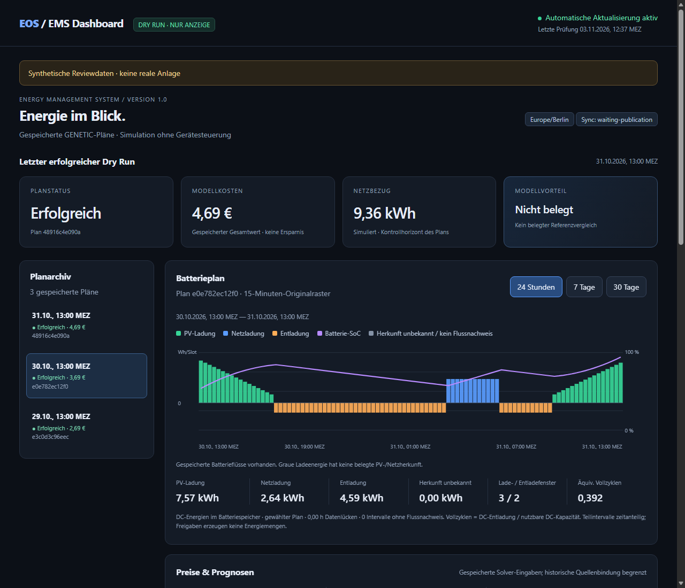
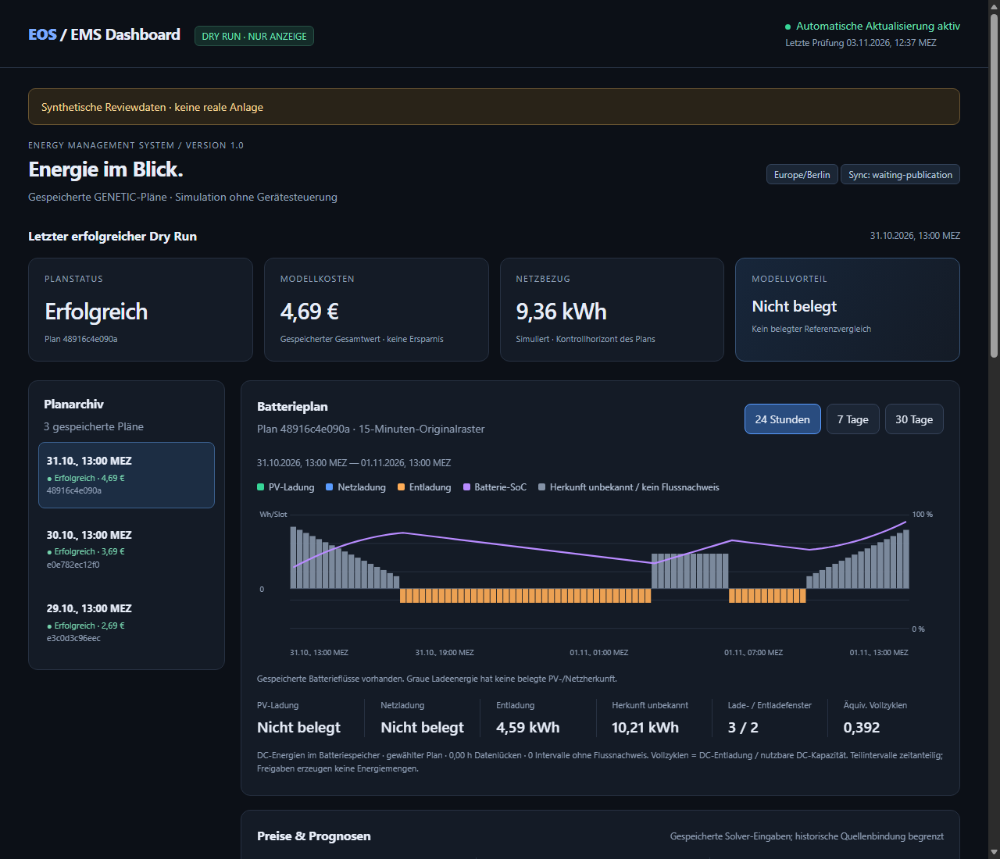
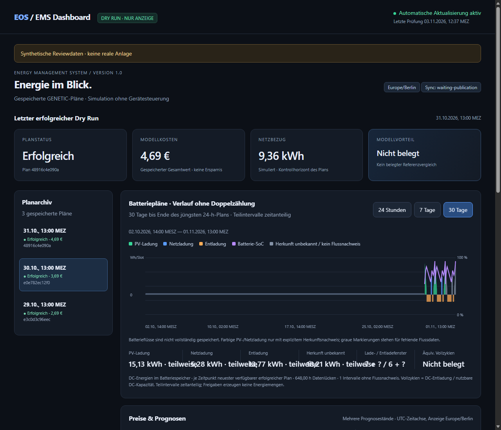
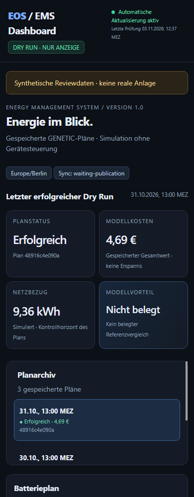
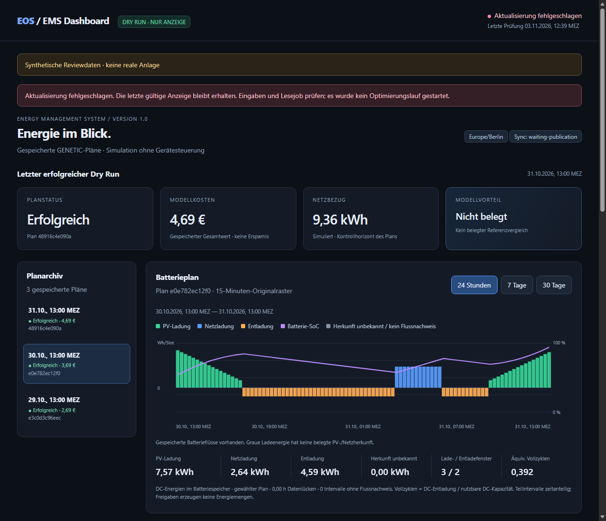

# EMS Dashboard v1.0 – Review und Abnahme

Basis: PR #23, `38d7ea31182cbcc5ed07e7b496bdcbbecad952fb`.
Branch: `dashboard/ems-v1`; Reviewziel: `release/pr22-contract-fixes`.
Dieser gestapelte Review ändert Main, PR #22 und PR #23 nicht. PR #23 kann
unabhängig weiter geprüft werden. Kein Merge, Release oder Deployment in diesem Auftrag.

## Ergebnis

Lokales statisches Dark-Mode-Dashboard für bereits gespeicherte GENETIC-Dry-Runs:
letzter erfolgreicher Plan, ursprüngliche Modellkosten, simulierter Netzbezug,
optional belegter gespeicherter Modellvorteil, auswählbares Planarchiv, Batterie-
und Prognosediagramme, 24 h/7 d/30 d, Energie-/Fenster-/Vollzykluskennzahlen und
Originalintervall-Details mit Nachweisstatus. Bedienbar per Maus und Tastatur;
responsive Mobilansicht ohne horizontales Seitenüberlaufen.

Der kurze Exportjob liest die bestehende Ausgabe unter dem gemeinsamen Synclock.
Fertiges HTML wird im eigenen Zielverzeichnis atomar ersetzt. Die lokale Datei
lädt alle 60 Sekunden neu. Ein minütlicher Unraid-Lesejob nutzt Python im bereits
laufenden Helfer, ohne zweite Helferschleife oder Container. Atomarer Fehlererhalt,
Banner, Zeitstempel und Staleness-Warnung verhindern eine unbemerkte falsche Anzeige.

Die [private Unraid-Anleitung](EMS_DASHBOARD.md) beschreibt konkrete Befehle,
Bundle-/Hashprüfung, privaten Dateizugang, Scheduler, Economics-Cache, Fehlersuche
und Rücknahme. Sie wurde nicht produktiv ausgeführt.

## Screenshots – ausschließlich synthetische Daten

Die Beispiele enthalten bewusst einen vollständig gespeicherten Herkunftssplit,
einen Tag mit unbekannter Ladeherkunft und fehlenden Referenzvergleich. Die Farben
entsprechen dem Auftrag: PV grün, Netz blau, Entladung orange, SoC violett.

### Desktop mit nachgewiesener gespeicherter Herkunft



### Unbekannte Herkunft



### 30-Tage-Navigation und Datenlücken



### Mobilansicht, 390 Pixel



### Ungültige Eingabe: letzter gültiger Stand bleibt sichtbar



## Datenvertrag und Änderungen

- Inspector und gemeinsamer historischer Doctor-Vertrag bleiben die Prüfbasis.
  Inspector bekommt nur optionale Lesebudgets und einen optionalen zeitlichen
  Filter; seine bisherigen Defaults, CLI und Bewertungsregeln bleiben bestehen.
  Der deterministische Inspector-Bundlehash wurde entsprechend neu berechnet.
  Historischer Validator und eingebetteter Doctor-Enginehash sind unverändert.
- Keine neuen Flüsse aus `ac_charge`, `dc_charge`, `discharge_allowed`, PV-Angebot,
  Gesamt-Netzbezug oder SoC-Differenzen. Herkunftsfarben nur für ausdrücklich
  gespeicherte DC-Intervallenergien mit passender Zeit-/Rastermetadatenbindung.
  Fehlende Mengen und unbekannte Herkunft bleiben getrennt sichtbar.
- Der optionale gespeicherte Flussvertrag und die Definition äquivalenter
  Vollzyklen stehen in der Betriebsanleitung. Kein Produzent, kein Backfill,
  keine Änderung produktiver Ausgabedateien. Bestehende EOS-Dateien ohne diesen
  Vertrag liefern folgerichtig keine behaupteten PV-/Netzlademengen.
- Preis/PV/Last stammen aus gespeicherten Solver-Eingaben oder der vorhandenen
  unabhängigen Archivbindung. Legacy-Eingaben bleiben als begrenzt belegt markiert;
  heutige laufende Forecast-/Preis-/SoC-Dateien werden nie rückwirkend eingesetzt.
- Historie ist eine UTC-Zeitachse mit expliziten Lücken. Pro Zeitpunkt gewinnt
  der neueste bereits verfügbare erfolgreiche Kontrollplan; kein Tail, kein
  vorgezogener künftiger Plan und keine doppelte Energie. Teilintervalle werden
  zeitanteilig gewichtet; Originalwerte bleiben unverändert zugänglich.
- Die Anzeige verwendet nur schon berechnete, ausdrücklich übergebene Economics-
  Reports mit passendem Lösungsbyte-/Projektions-/Engine-Nachweis, gespeichertem
  nativen Replay und konsistenter Abrechnung bei gemeinsamer Endwertkurve.
  Keine automatische Baseline-/GENETIC-Wiedergabe im Exportjob. Fehlender oder
  nicht passender Vergleich bedeutet `Nicht belegt`; Kosten sind keine Ersparnis.
- Aktive Historie zeitlich auf 37 Tage vor dem letzten erfolgreichen Planstart
  begrenzt, damit ältere Originaldateien dauerhaft liegen bleiben können.
  Sicherheitsbudgets bleiben explizit; Überlast liefert Fehlererhalt, keine Löschung.

## Durchgeführte Prüfungen

| Prüfung | Ergebnis |
| --- | --- |
| Vollständige Suite mit lokalem gepinntem EOS-Quellbaum | **632 passed / 3 deselected** |
| Dashboard, Wrapper und gespeicherter nativer Vergleich | **46 passed**; Teilmenge der vollständigen Suite |
| Dashboard plus R1/R2/R3-/Writer-Pipeline, UID 10001, read-only, network none | **111 passed** |
| Unabhängige ursprüngliche PR22-Gegenprobe | **R1 PASS / R2 PASS**, falsche Archive bleiben abgelehnt |
| Ruff, gepinntes Actionlint 1.7.7, Shell-/JS-Syntax, Diffprüfung | bestanden |
| Gemeinsame Engine-/Wrapper-/Transporthashprüfung | bestanden; historische Engine unverändert |
| Unverändertes Produktionsimage `sha256:7e957da…` | Dashboard-Leser mit UID 10001, read-only, network none, ohne Quellcode-Mount bestanden |
| Historischer Doctor im selben unveränderten Image | **6 Szenarien bestanden**, keine installierten aktuellen Helfermodule vorausgesetzt |
| Echter Edge-Browser, lokale statische Datei | Desktop/Mobil, Planwechsel, alle Zeiträume, Paginierung, Balken-/Originaldetails bestanden |
| Neues synthetisches reguläres Ereignis → Export → Browser-Neuladen nach 60 s | bestanden, Planzahl 3 → 4, **0 externe Requests / 0 Browserfehler** |
| Beschädigte Eingabe / gesperrter Sync / Transportfehler / abgeschnittenes HTML | letzte gültige Anzeige erhalten, Fehler sichtbar; keine Teilveröffentlichung |

Die vollständige native Suite nutzt ausschließlich den gepinnten lokalen EOS-
Quellbaum `8a8cd43a1915668927eda5504b7de039c2e762b4` und die vorhandene lokale
Testumgebung. Testcontainer haben kein Netzwerk; die drei als `genetic_execution`
markierten echten Suchläufe sind ausgeschlossen. Native Forward-Replays in den
Wirtschaftlichkeitstests sind feste gespeicherte Freigaben und keine Optimierersuche.

Der erste Versuch mit dem alten Testimage ohne eingebundenen vollständigen EOS-
Quellbaum hatte einen fehlenden Upstream-Import. Dies war keine erfolgreiche
Abnahme. Der vollständige erneute Lauf mit dem gepinnten Quellbaum ist der oben
angegebene Nachweis. Die mobile Browserprüfung fand einen Layoutüberlauf; dieser
ist korrigiert und die erneute 390-Pixel-Prüfung besteht.

Altimage-Dashboard-Bundle beim abschließenden Test:
`b8fe60da4d3207a08a3509c979d21dc46552e1e6d90dd3fa2f120d3af4655c3a`.
Der Hash gilt für Code, nicht für die Authentizität privater Fremddaten.

Reproduzierbare Einstiegspunkte:

```bash
pytest -q -m 'not genetic_execution'
pytest -q tests/test_dashboard.py tests/test_dashboard_wrapper.py tests/integration/test_dashboard_cached.py
ruff check src tests scripts
python scripts/update_evidence_transports.py
PYTHONPATH=src:scripts:tests python review/pr22_contract_probe.py
python scripts/dashboard_container_smoke.py --docker-context default \
  --image ghcr.io/vbeinlich/eospvprognosehelfer@sha256:7e957da3e2fdb67456a46e5538ad3c74b43fa21892d2998e93bca9de83d9daf7
python scripts/dashboard_fixture.py --destination /PRIVATE/synthetic-source
mkdir /PRIVATE/synthetic-site
python -m eos_pv_helper.dashboard --source /PRIVATE/synthetic-source --destination /PRIVATE/synthetic-site
node scripts/dashboard_ui_smoke.mjs --browser /PATH/TO/CHROMIUM \
  --html /PRIVATE/synthetic-site/index.html --expect-event --event-python python \
  --event-source /PRIVATE/synthetic-source
```

Die bestehende PR-CI wurde um das Dashboard-Altimage, synthetische Ereignisse und
den echten Browserrefresh erweitert; die bestehenden R1/R2/R3-Gates bleiben
verpflichtend. Keine neuen Veröffentlichungsrechte oder Publisher.

## Private reale Daten und offene Abnahme

Lokal vorhandene Originalantworten vom **29. und 31.10.2026** wurden erneut mit
unveränderten Bytes und Änderungszeiten gelesen, jeweils 24 Originalstunden.
Die daraus erzeugte Vorschau bleibt ausschließlich im ignorierten privaten
Arbeitsverzeichnis. Ohne damals zugehörigen Sync-State bleiben diese Antworten
`claim_status=unmatched`; kein erfolgreicher Claim wird erfunden.

Für den **30.10.2026** liegt lokal weiterhin kein lesbarer Originalinhalt vor.
Der dokumentierte Bestand zeigt die Dateiexistenz auf dem NAS, aber verweigerten
Lesezugriff auf Original und damaligen Sync-State. Der synthetische Tag 30.10.
prüft die Oberfläche, ersetzt diesen echten Nachweis jedoch nicht.
Siehe [vorhandene private Inventur](HISTORICAL_ACTUALS_INVENTORY.md).

Die Abnahme aller drei realen Tagespläne samt Claimzuordnung und der konkreten
SMB-/Browser-/Schedulerkombination auf Unraid bleibt deshalb offen. Für einen
lesbaren privaten Pfad wurde nachgefragt; keine Zugangsdaten, Rechteänderung oder
Umgehung durchgeführt. Keine privaten Pläne, Messwerte oder Zugangsdaten in GitHub.

Notwendige nächste Gates: unabhängiger Dashboardreview, Abschluss der einschlägigen
Basisreviews, private Unraid-Abnahme und anschließend ausdrückliche Aktivierungs-
freigabe. Issue #21 bleibt offen, `exact_solver_options_proven=false`.
Keine Garantie einer global optimalen Planung, realisierter Einsparung oder
atomarer No-Device-Ausführung wird aus der Dashboardanzeige abgeleitet.

**Keine echten Optimierungsläufe, Merges, Releases, produktiven Container,
Portfreigaben, Scheduler-/Geräte-/Produktionskonfigurationsänderungen ausgeführt.**
