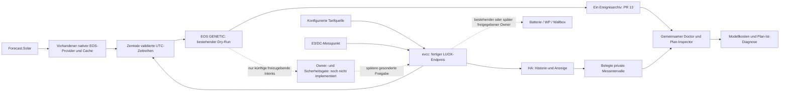

# Zielarchitektur: Daten einmal beziehen, Pläne getrennt von Ausführung bewerten

Entwurf vom 01.11.2026. Kein Aktorcode, keine Installationsänderung oder
Steuerfreigabe. Die vorhandenen Writer behalten ihre Zuständigkeit; konkurrierende
Steuerinstanzen werden weder gestartet noch eigenmächtig deaktiviert.

## Maßgebliche Quellen und Verteilung

| Datenart | Maßgebliche Quelle im Ziel | Interne Verbraucher / Grenze |
| --- | --- | --- |
| PV-Prognose | Bestehender nativer EOS-Forecast.Solar-Pfad mit Cache/TTL/Lock | Helfer normalisiert einmal; EOS und später EMHASS/HA erhalten dieselben versionierten Werte. Kein zweiter Wetterclient |
| Finale dynamische Preise | Bereits konfigurierte evcc-Tarifquelle | Fertige EUR/kWh-Reihe an Helfer/EOS/HA, einmalige Einheitenkonvertierung; keine zweite LUOX-/Markt-Abfrage |
| E3/DC PV/Netz/Batterie/SoC | Ein bestätigter physikalischer Messpunkt, bevorzugt vorhandener evcc-RSCP-Pfad | Originalzeit, Einheit und AC/DC-Bezug mitgeben; HA archiviert, EOS nutzt bestätigte Frische |
| Hauslast Ist | Vollständige Standortbilanz des bestätigten Zählers | Loadpoint-Abgrenzung nachweisen; WP/EV nicht doppelt addieren oder unterschlagen |
| Lastprognose | Aktueller nativer EOS-Provider | 11.251 kWh aktiv konfiguriert; Definition Gesamtverbrauch gegenüber Netzbezug und historische Laufbindung noch prüfen |
| WP-Temperaturen, Sperren, Verdichter | M-TEC-eigene Statusquelle | Nur read-only Capability-/Regellogikprüfung; elektrische Aufnahme nicht mit thermischer Leistung verwechseln |
| EV-SoC/Abfahrt/Wallboxdaten | evcc mit den bereits eingerichteten Quellen | Zwei Fahrzeuge separat identifizieren; kein zweiter Hersteller-Cloudclient für EOS oder HA |
| Ausführungsnachweis | Künftig bestätigte Owner-Transaktion und unabhängige Messung | Anforderung, Annahme und tatsächliche Wirkung getrennt; nicht aus GENETIC-Freigaben erzeugen |

Die aktuelle evcc-Frischeprüfung ist eng auf 0.318.1 und ungecachte RSCP-Getter
geprüft. `/api/state`, `historyUpdated`, gleiche/geänderte Werte sind keine
Messzeitgarantie. Keine Zentralisierung darf die 300-s-Grenze umgehen. Ein Broker
muss zuerst dieselben Originalzeit-/Frischebeweise liefern; vorhandene Sicherheits-
Fallbacks werden nicht zugunsten weniger Abfragen entfernt.

Der Config-GET vor einem Lauf ist keine atomare Solver-Snapshot-Garantie.
Tatsächliche Eingaben/Parameter aus der Lösung werden unverändert archiviert;
beobachtete globale Optionen bleiben als Beobachtung markiert. Für volle
Laufkonfigurationsprovenienz braucht der EOS-Antwortvertrag zusätzliche belegte
Metadaten oder eine explizit geprüfte gleichwertige Methode (weiteres Gate zu #12).

## Genau ein künftiger Befehls-Owner pro Gerät

Vorschlag: EOS plant, evcc bleibt der bestehende lokale Ausführungskoordinator.
Home Assistant beobachtet/visualisiert und liefert bestätigte Nutzeranforderungen;
keine zweite stille Modbus-/RSCP-Steuerung. Dieser Vorschlag ist vor Implementierung
durch den Betreiber zu bestätigen. Die installierten tatsächlichen API-/Firmware-
Verträge sind erst zu prüfen; heutige Dokumentation beweist keine Funktion einer alten Version.

### E3/DC einschließlich Netzladung

Erst Owner-Inventar, Privatkonfiguration und Rücklesevertrag klären: Hersteller-
Automatik, evcc und mögliche zusätzliche Tools dürfen nicht gegeneinander arbeiten.
Notstromreserve, nutzbare Kapazität, Netz-/Wechselrichter-/Batterieleistung und
Frische sind harte Grenzen. Netzladung braucht unter anderem wirtschaftlich
belegten Spread nach Verlusten/LCOS sowie eine begrenzte, widerrufbare Freigabe.

[evcc E3/DC](https://docs.evcc.io/en/meters/e3-dc/) beschreibt externe Batteriesteuerung
und weist auf das Übersteuern herstellereigener Smart-Power-/Operating-Range-
Einstellungen hin. Das ist ein Freigabegate, keine Aufforderung zum Einschalten.
[E3/DC-Energiemanagement](https://www.e3dc.com/en/energy-management/) beschreibt
prognosebasiertes Laden: die vereinfachte sofortige PV-Eigenverbrauchsreferenz
ist deshalb nicht automatisch der reale herstellereigene Standardbetrieb.

### M-TEC WPD618: PV-Funktion, SG-Ready und Modbus

PV-Analog-Leistungsbudget und SG-Ready-Anforderung sind unterschiedliche Verträge.
Keine gleichzeitigen unabhängigen Writer für Register 1000 oder SG-Ready-Kontakte.
Die historisch nachgewiesene Signalkette ist kein Nachweis aller Heiz-/Warmwasser-
Freigaben oder eines präzisen elektrischen Leistungssollwerts. Betriebsart, Hysterese,
Temperaturen, Sperrzeiten, normale Anforderung und tatsächlich laufender Verdichter
bleiben getrennt. Keine Komfortgrenzen oder Herstellerparameter verändern.

[M-TEC-Vernetzung](https://www.mtec-systems.com/waermepumpen/vernetzung-und-steuerung/)
bestätigt die allgemeine Smart-Grid-Funktion, nicht das konkrete WPD618-Pin-/Register-
Mapping. Dieses braucht Hersteller-/Installateurbeleg und installierte Definitionen.
[evcc-Heizungsmodell](https://docs.evcc.io/en/heating/) behandelt die Anforderung an
eine intern weiterregelnde WP. Eine Anforderung ist kein gemessener Verdichterbefehl.

### Zwei EVs über evcc

Zuerst Fahrzeugidentitäten, Ladepunkte, gemeinsames oder getrenntes Ladegerät,
Phasen-/Stromgrenzen, angeschlossenes Fahrzeug, verlässlicher SoC und Abfahrtsziele
privat zuordnen. Anzahl Ladepunkte ist nicht Anzahl Autos. Keine erfundenen Kapazitäten,
keine angenommene Ladeleistung, kein V2H/V2G ohne bestätigte Geräteeigenschaft.
WP, Batterie und beide EVs teilen denselben bestätigten Hausanschlussrahmen.

Die heutige Helfer-Dispatchprüfung blockiert unvalidierte EVs bewusst. Diese
Schranke wird nicht für das Zielbild entfernt. Ein künftiger vollständiger
Mehrgerätevertrag erfordert eigene Tests und Freigabe.

### Home Assistant, HA-Bridge und Ledger

HA ist Anzeige-/Historieninstanz, nicht paralleler Batterie-/WP-Writer. Bestehende
#7/#11 behalten ihre eigene Migration/Supervision; keine Worker starten oder
manuelle Prozesse beenden. `POST /api/states` ist keine Methode, fehlende historische
Messungen rückzudatieren. [HA-Sensorvertrag](https://contributors.home-assistant.io/core/entities/sensor/)
und belegte Zähler-/Statistikmetadaten sind Grundlage des read-only Exports.

## Priorisierte Umsetzung – zunächst ohne Gerätesteuerung

| Priorität | Arbeitspaket | Abhängigkeit / Abnahme |
| --- | --- | --- |
| P0 | Integration und private Ereignisabnahme (#9/#10/#12, dieser Review) | CI, Ursprung/Hashes, Publishing-Sperren, Operatorentscheidung; nächste reguläre Optimierung abwarten |
| P0 | [Atomarer EOS-Laufvertrag #21](https://github.com/vbeinlich/EOSPVPrognoseHelfer/issues/21) | Optionsprovenienz und No-Device-Eigenschaft nicht aus vorherigem Config-GET ableiten |
| P0 / E1 | [Ist-Export und LUOX-/Meter-Abgrenzung #16](https://github.com/vbeinlich/EOSPVPrognoseHelfer/issues/16) | Bestehende Historie lesen, keine Nachfüllung; vollständige Intervalle/Preisversionen, keine Geheimnisse |
| P1 / E2 | [Referenz-/Verlust-/LCOS-/Jahreslast-Kalibrierung #17](https://github.com/vbeinlich/EOSPVPrognoseHelfer/issues/17) | Belegte Ist-Daten und Hersteller-Standardmode; kleine Vorteile inklusive Unsicherheit bewerten |
| P1 / E3 | [Owner-/Intent-Vertrag und E3/DC-Netzladung #18](https://github.com/vbeinlich/EOSPVPrognoseHelfer/issues/18) | Nur Design/Offline-Validierung; spätere Aktorimplementierung und Aktivierung separat freigeben |
| P1 / E4 | [M-TEC Capability-/PV-/SG-Ready-Vertrag #19](https://github.com/vbeinlich/EOSPVPrognoseHelfer/issues/19) | Herstellermapping, vorhandene Writer, Anforderung/Ack/Wirkung; kein Registertest in diesem Auftrag |
| P2 / E5 | [Zwei-EV-Bedarfe und Standortrestriktionen #20](https://github.com/vbeinlich/EOSPVPrognoseHelfer/issues/20) | Private Zuordnung/SoC-Frische, keine neuen Herstellerabfragen, keine Wallboxbefehle |
| P2 | Gemeinsame Wizard-/Doctor-/Analyseoberfläche (#5), optionale Ledger-Supervision (#11) | Dieselbe Daten-/Doctor-Engine, kein zweiter Pflicht-Webserver; Migration gesondert |

Vor echter Steuerung zusätzlich: Grenzen/Timeouts/abgelaufene Intents, eindeutige
Plan-/Event-Zuordnung, Rücklese-/Messnachweis, manuelle Übersteuerung, Ausfall-
Rückkehr zur Herstellerautomatik und getesteter Rollback. Diese Anforderungen
werden hier dokumentiert; es existiert noch kein neuer Steuerpfad.
